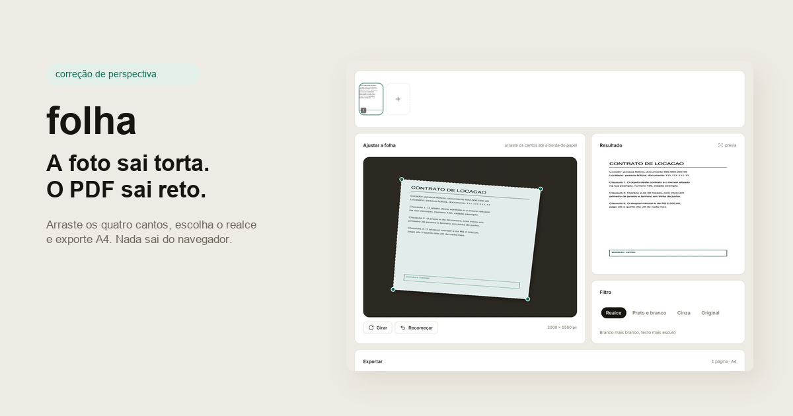

# folha

Turn a photo of a document into a straight, readable PDF. No sign up, no upload, no server: the image is corrected and the file is assembled inside the browser.

Built for the everyday case: someone photographs a contract, a receipt or a form on a desk, the photo comes out crooked, and the file has to be sent today.



## What it does

| step | what happens |
|---|---|
| add | drag photos, pick files or shoot with the camera |
| straighten | drag the four corners to the paper edge; the quad is warped back to a rectangle |
| clean | realce, preto e branco or cinza, applied on the corrected image |
| export | one PDF, A4, one page per photo |

Everything runs on the device. After the page loads, the app makes no network request with your images.

## How the straightening works

The four corners describe a quadrilateral in the photo. A homography maps the output rectangle back to that quadrilateral, and each output pixel samples the source with bilinear interpolation. The crop is inset by 0.6% so the edge of the paper does not pick up the desk.

The black and white filter is not a global threshold: it computes a local mean with an integral image and marks a pixel as ink when it is clearly darker than its neighbourhood. That keeps text readable under uneven light.

The PDF is written by hand, object by object: each page embeds the JPEG with `DCTDecode`, so there is no PDF library and no re-encoding beyond the JPEG itself.

## Stack

React 19, Vite, Tailwind CSS v4 and Motion. The interface is assembled from [beUI](https://beui.dev) components copied into `src/components/motion`: card, alert, input, select, tabs, tooltip and bottom sheet.

## Run

```bash
npm install
npm run dev
```

Then open the printed local address. `npm run build` writes a static `dist/`.

## Limits

- Corners are manual. There is no automatic edge detection, which keeps the result predictable and the code small.
- Input is anything the browser can decode. HEIC from an iPhone usually needs conversion first.
- Photos larger than 2600 px on the long side are downscaled before editing.
- The PDF is raster: text is not selectable.

## License

MIT. Made by [robertlogan.cc](https://robertlogan.cc).
