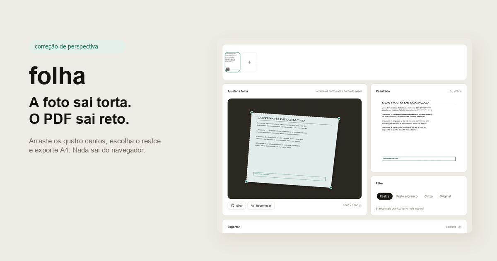

# folha

Transforme a foto de um documento em um PDF reto e legível. Sem cadastro, sem upload, sem servidor: a imagem é corrigida e o arquivo é montado dentro do navegador.

Feito para o caso do dia a dia: alguém fotografa um contrato, um recibo ou uma ficha em cima da mesa, a foto sai torta, e o arquivo precisa ser enviado hoje.



## O que faz

| passo | o que acontece |
|---|---|
| adicionar | arraste fotos, escolha arquivos ou use a câmera |
| endireitar | arraste os quatro cantos até a borda do papel; o quadrilátero volta a ser retângulo |
| limpar | realce, preto e branco ou cinza, aplicados sobre a imagem corrigida |
| exportar | um PDF, A4, uma página por foto |

Tudo roda no aparelho. Depois que a página carrega, o app não faz nenhuma requisição de rede com as suas imagens.

## Como o endireitamento funciona

Os quatro cantos descrevem um quadrilátero na foto. Uma homografia leva o retângulo de saída de volta para esse quadrilátero, e cada pixel de saída amostra a origem com interpolação bilinear. O recorte entra 0,6% para dentro para a borda do papel não puxar a mesa.

O filtro preto e branco não é um limiar global: ele calcula a média local com imagem integral e marca um pixel como tinta quando ele é claramente mais escuro que a vizinhança. Isso mantém o texto legível com luz irregular.

O PDF é escrito à mão, objeto por objeto: cada página embute o JPEG com `DCTDecode`, então não existe biblioteca de PDF nem recodificação além do próprio JPEG.

## Base técnica

React 19, Vite, Tailwind CSS v4 e Motion. A interface é montada com componentes do [beUI](https://beui.dev) copiados para `src/components/motion`: card, alert, input, select, tabs, tooltip e bottom sheet.

## Rodar

```bash
npm install
npm run dev
```

Depois abra o endereço local impresso no terminal. `npm run build` gera um `dist/` estático.

## Limites

- Os cantos são manuais. Não existe detecção automática de borda, o que mantém o resultado previsível e o código pequeno.
- A entrada é qualquer formato que o navegador decodifique. HEIC de iPhone normalmente precisa de conversão antes.
- Fotos maiores que 2600 px no lado maior são reduzidas antes da edição.
- O PDF é raster: o texto não é selecionável.

## Licença

MIT. Feito por [robertlogan.cc](https://robertlogan.cc).
